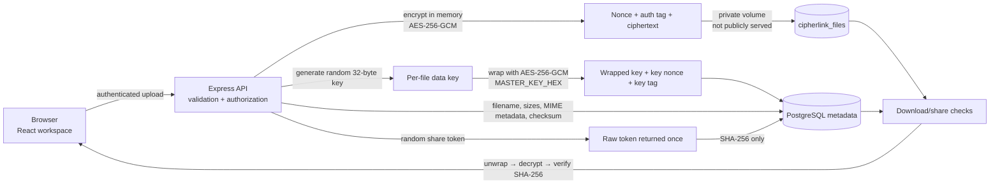

# CipherLink

> A private file exchange that encrypts files before storage and makes sharing rules visible, reversible, and auditable.

CipherLink is a portfolio project for practicing security-conscious product engineering across a React client, an Express API, PostgreSQL metadata, and private encrypted file storage. A user uploads a file, reviews its integrity metadata, creates a link with an expiration and optional download limit, and can revoke that link from the same workspace.

The project is intentionally honest about its boundary: CipherLink provides **server-side encryption at rest**, not end-to-end encryption. The API can unwrap a file key and decrypt a file when an authorized download is requested.

## Recruiter snapshot

| Layer | Implementation |
| --- | --- |
| Client | React + TypeScript + Vite |
| API | Node.js 22 + Express + TypeScript |
| Data | PostgreSQL 16 |
| File protection | AES-256-GCM, per-file keys, SHA-256 integrity checks |
| Access control | bcrypt password hashing, two-hour JWT sessions, owner-scoped queries |
| Local delivery | Docker Compose or two local development processes |

## Why it exists

Many file-sharing interfaces make the recipient experience simple while hiding the decisions that matter: where a file lives, how long a link works, how many times it can be used, and whether the owner can take access back. CipherLink turns those decisions into the product surface. The interface shows the sharing journey, the API enforces each rule, and the security page explains the trust boundary without calling the system “zero knowledge.”

## Product journey

1. **Sign in** — use the seeded local demo account or register a new account. Passwords are hashed with bcrypt and sessions are signed JWTs.
2. **Upload** — choose a non-empty `.txt`, `.pdf`, `.png`, `.jpg`, `.jpeg`, `.json`, `.csv`, or `.zip` file. The default server limit is 10 MiB.
3. **Review** — inspect the filename, content type metadata, sizes, SHA-256 checksum, and share history from the file detail view.
4. **Create controlled access** — choose an expiry from one hour to one year and an optional limit of 1–1,000 downloads. The raw share token is returned once so it can be copied into a link.
5. **Recipient download** — the public share page verifies the link state before offering a download. Each request checks expiration, revocation, and remaining downloads.
6. **Revoke and audit** — revoke an active link, delete a file, and review login, upload, download, share, rename, revoke, and deletion events in the audit trail.

## Feature highlights

- **Private encrypted storage** — uploaded bytes are encrypted by the API before they are written to the `cipherlink_files` volume; that volume is never served as static web content.
- **Envelope-style key handling** — every file receives a random 32-byte data key. The data key is wrapped with the deployment master key instead of reusing one key for every file.
- **Controlled links** — share tokens are generated with cryptographically secure randomness, stored only as SHA-256 hashes, and checked on every public request.
- **Integrity verification** — AES-GCM authentication is checked during decryption and the plaintext SHA-256 checksum is verified before a download is sent.
- **Owner authorization** — file and share queries include the authenticated owner, so an ID alone is not sufficient to access another user’s records.
- **Input and HTTP hardening** — filename sanitization, extension and size checks, in-memory upload limits, Helmet headers, a CORS allow-list, a JSON body limit, and application-wide rate limiting are enabled.
- **Explainable UI** — upload progress, share state, remaining downloads, revocation, audit history, and the server-side encryption boundary are visible in the product rather than hidden in implementation details.

## Encryption architecture



### What happens at each boundary

1. The API receives the upload and keeps it in memory while it validates the extension, size, non-empty content, and sanitized basename. The multipart MIME value is retained as metadata/response content type; this project does not perform deep file-type sniffing or malware scanning.
2. `encryptFile` generates a new 32-byte file key and seals the plaintext with AES-256-GCM using a random 12-byte nonce. The stored file bytes are `nonce + authentication tag + ciphertext`.
3. The file key is separately wrapped with AES-256-GCM using `MASTER_KEY_HEX`. PostgreSQL stores the wrapped key material, checksum, and descriptive metadata; the encrypted bytes go to private file storage.
4. A download unwraps the key, authenticates the ciphertext, verifies the SHA-256 checksum, and only then sends plaintext to the authenticated response. A share download follows the same decryption path after its link checks pass.
5. A share token is generated with `randomBytes`, returned in the create response, and immediately reduced to a SHA-256 hash for persistence. The raw token is not stored by the API.

The application does not terminate TLS. Local development uses HTTP; a deployment must put the API and frontend behind HTTPS and protect its environment secrets separately.

## Demo access (local only)

The seed command creates the disposable local account `demo@cipherlink.local`. Its password is the value of `DEMO_PASSWORD` in your untracked `.env`; if the variable is omitted, `src/seed.ts` uses a development-only fallback. The repository does not contain a production credential, API token, or live demo account.

For a safe walkthrough, set your own `DEMO_PASSWORD` locally, start the stack, sign in, upload a small sample file, create a short-lived link, open the link in a private browser window, revoke it, and review the resulting audit records. The sign-in form is prefilled with the local demo email and can be edited for a custom local password.

See [`docs/DEMO.md`](docs/DEMO.md) for the click-by-click runbook and reset instructions.

## Quick start with Docker

### Prerequisites

- Docker Desktop with the Compose plugin
- Node.js 22+ (only needed to generate local development values or run checks outside Docker)

### Start the complete stack

1. Create an untracked environment file:

   ```powershell
   Copy-Item .env.example .env
   ```

2. Generate two random 32-byte hex values. Run the command twice and place one result in `JWT_SECRET` and the other in `MASTER_KEY_HEX` inside `.env`:

   ```powershell
   node -e "console.log(require('node:crypto').randomBytes(32).toString('hex'))"
   ```

   `MASTER_KEY_HEX` must be exactly 64 hexadecimal characters. Keep both values local; never commit `.env`.

3. Set a local-only `DEMO_PASSWORD` with at least 10 characters in `.env`, then build and start:

   ```powershell
   docker compose up --build
   ```

4. Open the product at [http://localhost:5174](http://localhost:5174). The API health check is [http://localhost:4000/api/health](http://localhost:4000/api/health). A healthy response is a small JSON status document, not an interactive API explorer.

Stop the stack with `Ctrl+C`, or run `docker compose down`. To reset the local database and encrypted-file volume as well, use `docker compose down -v` and understand that this deletes local demo data.

## Local development without Docker

1. Install Node.js 22+ and run PostgreSQL 16 or a compatible PostgreSQL service.
2. Create the environment file and replace the placeholders with local values:

   ```powershell
   Copy-Item .env.example .env
   ```

   Set `DATABASE_URL` to the local database, generate `JWT_SECRET` and `MASTER_KEY_HEX` as shown above, and choose a `DEMO_PASSWORD`.
3. Create the schema and seed the demo account:

   ```powershell
   npm install
   npm run seed
   ```

4. In one terminal, start the API:

   ```powershell
   npm run dev
   ```

5. In another terminal, start the Vite client. Its default API target is `http://localhost:4000/api`:

   ```powershell
   cd frontend
   npm install
   npm run dev
   ```

   Open [http://localhost:5173](http://localhost:5173). If you use another frontend origin, set `CORS_ORIGIN` and `VITE_API_URL` accordingly.

## Configuration reference

Values belong in an untracked `.env` file or in the deployment secret manager. The committed [`.env.example`](.env.example) contains placeholders only.

| Variable | Required | Purpose / default |
| --- | --- | --- |
| `DATABASE_URL` | Yes | PostgreSQL connection string |
| `JWT_SECRET` | Yes | Session signing secret; use a random value |
| `MASTER_KEY_HEX` | Yes | 32-byte key wrapping key represented by exactly 64 hex characters |
| `CORS_ORIGIN` | No | Browser origin allowed by the API; defaults to `http://localhost:5173` |
| `PORT` | No | API port; defaults to `4000` |
| `STORAGE_DIR` | No | Private encrypted-file directory; defaults to `private-storage` |
| `MAX_FILE_SIZE` | No | Upload limit in bytes; defaults to `10485760` (10 MiB) |
| `DEMO_PASSWORD` | No | Local seed password; the seed has a disposable development fallback |

## API surface

The source of truth for the route contract is [`docs/API.md`](docs/API.md) and `src/server.ts`. Registration and login are intentionally unauthenticated auth routes; the unauthenticated data-access routes are the health check and the public share endpoints.

All authenticated routes use `Authorization: Bearer <jwt>`. JWTs expire after two hours. The logout endpoint records an audit event and clears the browser session; it does not revoke an already-issued JWT before expiry.

## Threat model

| Risk / asset | What CipherLink does | Boundary that remains |
| --- | --- | --- |
| Accidental public exposure of stored bytes | Writes ciphertext to a private volume and never serves that directory directly | A host or process administrator can still read the volume and application environment |
| Unauthorized owner operations | Uses bcrypt passwords, signed sessions, and owner predicates on file/share queries | Browser bearer tokens must be protected; the current demo stores them in local storage |
| Guessable or stale links | Uses 32-byte random tokens, stores only hashes, and enforces expiry, revocation, and download limits | Anyone who obtains a valid link can use it until its rules stop it |
| Storage tampering or corruption | AES-GCM authentication and a SHA-256 checksum are verified before delivery | The service returns an error; it does not provide backup or recovery |
| Malicious upload input | Applies an extension allow-list, byte limit, non-empty check, safe basename, body limits, and rate limiting | There is no antivirus, content disarm, or deep MIME inspection |
| Metadata leakage | Does not store file contents or raw share tokens in audit records | Filenames, sizes, content-type metadata, checksums, timestamps, and share state are visible to the application database |

For the detailed decisions and limitations, read [`SECURITY.md`](SECURITY.md). This implementation has not undergone a professional security audit.

## Honest limitations and next hardening steps

- The demo stores bearer JWTs in browser local storage. A production deployment should use short-lived access tokens, secure HttpOnly refresh cookies, CSRF defenses, and a real revocation/session strategy.
- `MASTER_KEY_HEX` is an environment secret. Production key rotation, KMS/HSM integration, envelope-key versioning, and recovery procedures are not implemented.
- Local encrypted files use a single process-visible volume. Production scale would need object storage, backup/restore, resumable uploads, cleanup jobs, and operational observability.
- Uploads are buffered in memory and restricted by size; there is no streaming pipeline, antivirus scan, content-disarm step, or file-type signature inspection.
- The database schema is initialized with `CREATE TABLE IF NOT EXISTS` rather than versioned migrations, and the Docker database uses development credentials.
- Public downloads increment the counter in a separate update after the availability check. A high-concurrency production service should make the limit check-and-consume operation atomic.
- HTTPS termination, secret distribution, backups, monitoring, and incident response belong to the deployment environment and are not supplied by this demo.

## Validation

From the repository root:

```powershell
npm install
npm test
npm run build

cd frontend
npm install
npm run build
cd ..

docker compose --env-file .env.example config
```

`npm test` covers encryption/decryption and tamper rejection, filename and upload validation, bearer parsing, share availability, and a path traversal regression. The frontend currently uses its production build as its compile/bundle check. The runtime API image intentionally omits development tools such as `tsx`, so run the test suite from the host checkout rather than from the production container.

## Project story

I built CipherLink to explore a security-sensitive workflow where the right product behavior is as important as the cryptographic primitive. The core design choice was to make every sharing decision explicit: private-by-default storage, a visible expiry and download budget, one-time token display, revocation, and an audit trail.

The implementation keeps the trust model explainable. AES-256-GCM protects bytes at rest and per-file keys are wrapped, while the UI tells the user that the server can still decrypt for delivery. That honesty shaped the API, the security copy, and the threat model rather than being added as a disclaimer after the fact.

As a portfolio piece, CipherLink demonstrates a complete vertical slice: a polished React experience, a typed Node API, PostgreSQL persistence, Docker Compose orchestration, security-focused tests, and documentation that distinguishes implemented controls from production work still required.

## Repository map

- `src/server.ts` — Express routes, authentication, authorization, uploads, downloads, shares, and audit events
- `src/crypto.ts` — AES-256-GCM file encryption, key wrapping, checksums, and token hashing
- `src/security.ts` — reusable input and share validation helpers
- `src/db.ts` — PostgreSQL pool and schema initialization
- `src/seed.ts` — idempotent local demo-account seed
- `frontend/src/main.tsx` — React vault, file details, public share, audit, and security views
- `Dockerfile` / `frontend/Dockerfile` — API build and Vite development containers
- `docker-compose.yml` — PostgreSQL, API, frontend, and local named volumes
- `API.md` — short API entry point for GitHub browsing
- `SECURITY.md` — security decisions, threat assumptions, and reporting-oriented notes
- `docs/API.md` / `docs/DEMO.md` — detailed route reference and safe local demo runbook
- `docs/TEST_REPORT.md` — repeatable validation commands and known test gaps

## License

No license has been selected for this portfolio repository yet. Add one before accepting external contributions or reusing the code in another project.
